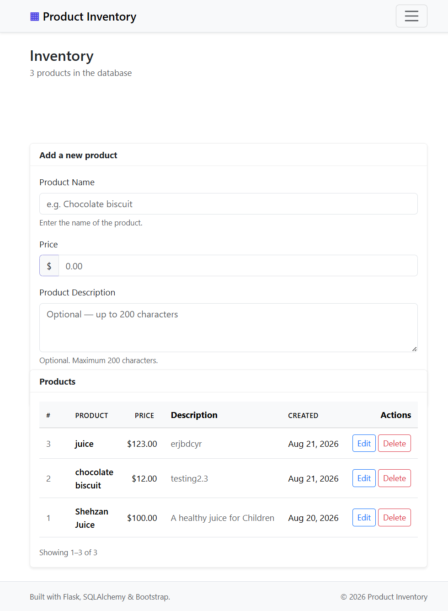
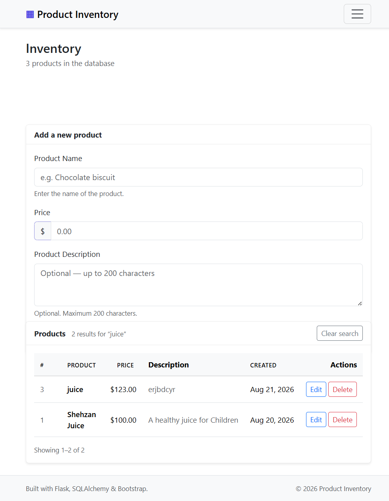

# Product Inventory

A small but production-shaped **Flask + SQLAlchemy** inventory app: keep track of
products, their prices and descriptions, search and sort them, and page through
a growing list.

It started as a "follow-along" CRUD tutorial and was then rebuilt properly —
application factory, blueprints, WTForms validation, CSRF protection,
migrations, a test suite and CI.

---


---

## Screenshots

The inventory page — add form on the left, sortable product table on the right,
with empty states and flash messages handled for you:



Search narrows the list, shows a result count and offers a one-click
"Clear search"; it composes with sorting and pagination
(`/?q=juice&sort=price&dir=asc`):



---

## Features

**Core**

- Full CRUD — create, read, update and delete products
- Server-side validation (WTForms) with inline error messages
- Post/Redirect/Get on every write, so refreshing never duplicates a row
- Flash messages for create / update / delete feedback
- Empty states for "no products yet" and "no search results"

**Listing**

- **Search** — case-insensitive, matches name *and* description, survives SQL
  wildcards (`%` and `_` are matched literally)
- **Sort** — by id, name, price or creation date, ascending or descending,
  through an allow-listed column map (never raw user input in SQL)
- **Pagination** — 10 per page, out-of-range pages redirect to the last page,
  and search + sort + page all compose: `/?q=juice&sort=price&dir=asc&page=2`

**Quality**

- CSRF protection on every state-changing form (delete is a `POST`, not a link)
- Application factory + Flask blueprints + extension objects
- Flask-Migrate / Alembic schema versioning
- `pytest` suite (45 tests) running against an isolated in-memory database
- `ruff` lint **and** format checks
- GitHub Actions CI on every push and pull request
- Custom styled 404 / 500 / expired-form pages, favicon, responsive layout

## Tech stack

| Layer      | Choice                                       |
|------------|----------------------------------------------|
| Framework  | Flask 3.1                                    |
| Database   | SQLAlchemy 2.0 via Flask-SQLAlchemy, SQLite   |
| Migrations | Flask-Migrate (Alembic)                      |
| Forms      | Flask-WTF + WTForms (validation + CSRF)      |
| Front end  | Bootstrap 5.3 (CDN) + small custom CSS/JS    |
| Tooling    | pytest, ruff, GitHub Actions                 |

## Quick start

Requires **Python 3.10+** (developed on 3.14).

```bash
# 1. Clone and enter the project
git clone https://github.com/YOUR_USERNAME/Flask2026.git
cd Flask2026

# 2. Create and activate a virtual environment
python -m venv env

# Windows
env\Scripts\activate
# macOS / Linux
source env/bin/activate

# 3. Install dependencies
pip install -r requirements.txt

# 4. Create the database schema
flask --app app db upgrade

# 5. Run it
flask --app app run --port 9000
# ...or the classic way
python app.py
```

Open <http://127.0.0.1:9000/>.

> The local database lives in `instance/products.db` and is git-ignored, so a
> fresh clone always starts clean.

## Configuration

Copy `.env.example` to `.env` and adjust it — `.env` is ignored by git.

| Variable         | Default           | Purpose                                  |
|------------------|-------------------|------------------------------------------|
| `SECRET_KEY`     | dev fallback      | Session/CSRF signing — **set this in production** |
| `FLASK_CONFIG`   | `development`     | `development`, `testing` or `production` |
| `DATABASE_URL`   | local SQLite file | Any SQLAlchemy URI, e.g. PostgreSQL       |
| `FLASK_RUN_PORT` | `9000`            | Port used by `python app.py`             |

## Routes

| Method     | Path                | Purpose                                  |
|------------|---------------------|------------------------------------------|
| `GET`      | `/`                 | List products (search / sort / paginate) |
| `POST`     | `/`                 | Create a product                          |
| `GET`      | `/edit/<id>`        | Pre-filled edit form                      |
| `POST`     | `/edit/<id>`        | Save changes                              |
| `POST`     | `/delete/<id>`      | Delete a product                          |
| `GET`      | anything else       | Styled 404 page                           |

## Project structure

```
Flask2026/
├── app.py                  # thin entry point → create_app()
├── config.py               # development / testing / production config
├── requirements.txt
├── pyproject.toml          # ruff + pytest settings
├── .env.example
├── .github/workflows/ci.yml
│
├── product/                # application package
│   ├── __init__.py         # create_app(), error handlers, template filters
│   ├── extensions.py       # db, migrate, csrf (unbound at import time)
│   ├── models.py           # Product
│   ├── forms.py            # ProductForm (validation)
│   └── routes.py           # CRUD blueprint + search/sort/pagination
│
├── templates/
│   ├── base.html           # layout, navbar, flash messages, footer
│   ├── index.html          # add form + product table
│   ├── edit.html           # edit form
│   ├── _macros.html        # sort headers + pagination macros
│   └── errors/             # 404, 500, expired-form
│
├── static/                 # style.css, main.js, favicon.svg
├── docs/                   # screenshots used in this README
├── migrations/             # Alembic revisions
└── tests/                  # conftest + route/model tests
```

## Development

```bash
pytest                      # run the test suite
ruff check .                # lint
ruff format .               # format

# After changing a model:
flask --app app db migrate -m "Describe the change"
flask --app app db upgrade
```

## Design notes

Things worth knowing if you are reading the code:

- **`delete` is a `POST` with a CSRF token.** A plain `/delete/1` link would be
  followed by link-prefetchers, scrapers and malicious sites alike.
- **Sorting goes through an allow-list.** `?sort=` is looked up in a dict of
  real columns, so a value like `price; DROP TABLE` can never reach SQL.
- **Search terms are escaped** before being wrapped in `LIKE %…%`, so typing
  `%` matches a literal percent sign instead of every row.
- **`Post/Redirect/Get`** on create and edit stops the browser refresh from
  re-submitting the form.
- **Extensions are created unbound** (`db = SQLAlchemy()`) and initialised in
  `create_app`, which is what lets tests spin up isolated apps with an
  in-memory database.

## Roadmap

- [ ] User accounts and ownership of products
- [ ] Product categories and filtering
- [ ] JSON API (`/api/products`) with pagination metadata
- [ ] Image uploads instead of the description-only view
- [ ] Dockerfile + deploy workflow

## License

MIT — see [LICENSE](LICENSE).
